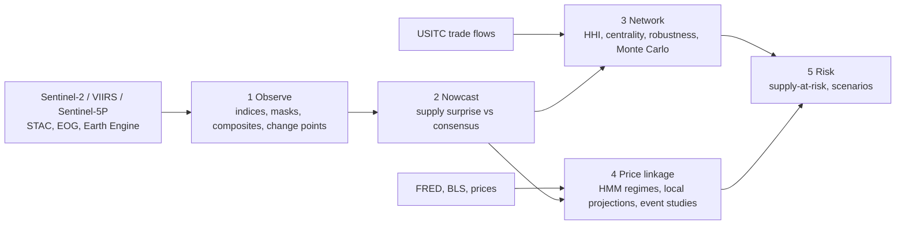

# GIS-ML-Commodities-Network

[](https://github.com/n9omi/GIS-ML-Commodities-Network/actions/workflows/tests.yml)

**Can free satellite observations of supply-chain nodes (fields, flare sites, mines, smelters) detect commodity supply
shocks before official statistics, how do those shocks propagate through concentrated supply networks, and does their
price impact depend on the macro regime?**

This repository is a working prototype of that pipeline for energy, agriculture and critical metals. It combines
remote sensing, machine learning, network theory and time-series econometrics, and every number in it is reproducible
from committed public data with one command.


## What the prototype delivers

| Layer | What it does | Data | Status in this snapshot |
| --- | --- | --- | --- |
| 1 Observe | Sentinel-2 NDVI/EVI over corn AOIs; SWIR hot pixels at mines and smelters; VIIRS Nightfire flaring in the Permian; Sentinel-5P SO2/NO2 and AlphaEarth embeddings (optional) | Planetary Computer STAC, EOG, Earth Engine | Live ingestion code, unit-tested on synthetic GeoTIFFs; runs with `bash run.sh --live` or the weekly GitHub Action |
| 2 Nowcast | Point-in-time supply nowcast with quantile boosting, conformal intervals, Diebold-Mariano tests | EIA production, WTI | Real outputs (Permian proxy) |
| 3 Network | Concentration, centrality, co-dependency communities, nestedness vs null, robustness, scenarios, Monte Carlo supply-at-risk | USITC DataWeb, 21 import + 8 export HTS6 lines, 2023 and 2025 | Real outputs |
| 4 Price linkage | HMM macro regimes; state-dependent local projections; event studies of 2025 copper disruptions | FRED, BLS, Alpha Vantage | Real outputs |
| 5 Risk | Supply-at-risk (VaR, expected shortfall) under correlated supplier failures | from layer 3 | Real outputs |

## Headline results (2025 snapshot)

Full tables: [`reports/RESULTS.md`](reports/RESULTS.md). All figures regenerate from `bash run.sh`.

- **Six of 21 US import lines behave like fewer than two suppliers** (1/HHI < 2): potash (Canada 87 %), rare-earth metals
  (China 83 %), uranium ores (Australia 80 %), lithium hydroxide (Chile 82 %), natural graphite (China 80 %) and
  permanent magnets (China 72 %).
- **A Chinese export stop would remove 58-83 % of US imports in four lines** (rare-earth metals and compounds, magnets,
  natural graphite). Removing the three most dominant suppliers (Canada, China, Indonesia) strips 37 % of supply across
  lines; three random removals strip 3 %.
- **Supply chains rewired between 2023 and 2025.** Top supplier changed in nine lines, including enriched uranium (Russia to
  the UK), palladium (Russia to South Africa), artificial graphite (China at 66 % to Indonesia), and PV cells and modules
  (to Indonesia). On the export side, China's share of US soybeans fell from 54 % to 18 %.
- **Concentration moves the tail, not the mean.** With identical supplier failure odds, every line has the same 5 %
  expected loss, but 95 % expected shortfall tracks HHI (correlation 0.97). Correlated, bloc-wide failures fatten the
  tails of diversified lines most.
- **A point-in-time Permian production nowcast beats an AR benchmark** (quantile boosting, Diebold-Mariano p = 0.01), and
  split-conformal bands cover 84 % of outcomes against an 80 % target, while the uncalibrated boosted 10-90 % band covers 65 %.
- **A one-standard-deviation upside Permian supply surprise moves WTI -2.7 % on impact** (90 % CI -5.0 to -0.4) and
  about -4 % after six months. A regime contrast appears only at one to two months and rests on few accommodative months.
- **Grasberg 2025: Freeport's abnormal return was -6 % in the incident week (not significant) and -22 % in the
  force-majeure week (t = -4.9).** That two-week gap is the information window a physical satellite signal is meant to
  exploit. The El Teniente event week is confounded by the July 30 US tariff decision on refined copper, and the
  pipeline records it as such.


## Architecture



## Methods in brief

Full specification with formulas and references: [`docs/METHODS.md`](docs/METHODS.md).

- **Remote sensing.** Windowed COG reads per AOI; Sentinel-2 baseline-04.00 radiometric harmonization; SCL cloud masking
  that keeps saturated pixels for hotspots; normalized hotspot indices (Marchese et al., 2019); leave-one-year-out
  anomalies; PELT change points with a simulation-calibrated penalty.
- **Machine learning.** Expanding-window rolling-origin evaluation with publication lags enforced; ridge, LightGBM
  quantile regression, split-conformal intervals, Diebold-Mariano-HLN tests; dynamic factor model (Kalman/EM).
- **Network theory.** Bipartite supplier x commodity graph; HHI and Hill-number effective suppliers; eigenvector, PageRank
  and betweenness centrality; cosine co-dependency with modularity communities; NODF nestedness against a curveball
  fixed-degree null; targeted vs random robustness curves; one-factor Gaussian-copula Monte Carlo for supply VaR and ES.
- **Econometrics.** Gaussian HMM with BIC and a minimum-occupancy rule, forward-filtered (real-time) states;
  state-dependent local projections with HAC errors; market-model event studies.

## Reproduce

```bash
git clone https://github.com/n9omi/GIS-ML-Commodities-Network && cd GIS-ML-Commodities-Network
python -m venv .venv && source .venv/bin/activate
pip install -r requirements.txt && pip install -e .
pytest                 # 38 tests, including end-to-end satellite reads on synthetic GeoTIFFs
bash run.sh            # rebuilds every table, figure and reports/RESULTS.md from data/raw/ (about a minute)
bash run.sh --live     # also ingests Sentinel-2 (no key needed); Nightfire and Sentinel-5P if configured in .env
bash run.sh --refresh  # also re-pulls market, macro, production and trade data (API keys in .env)
```

Satellite ingestion is resumable: each scene's result is appended to `outputs/satellite/*.csv`, and a rerun skips scenes
already processed. The `satellite-ingest` workflow does this weekly on GitHub Actions and commits the results.
Before the first live run, `python pipelines/02_ingest_satellite.py --live --thumbnails` renders a true-colour chip of every
AOI into `figures/aoi_checks/` so the coordinates can be checked by eye.

## Data

Raw API responses are committed byte-for-byte under `data/raw/` with a provenance table in
[`data/raw/SOURCES.md`](data/raw/SOURCES.md): FRED (DFII10, GS10, FEDFUNDS, UNRATE, DTWEXBGS), EIA Petroleum Supply
Monthly (US, Texas, New Mexico crude output), USITC DataWeb (general imports and total exports, HTS6, 2023 and 2025),
and Alpha Vantage (WTI spot, CPI, weekly FCX, SPY, CPER, CORN). Satellite sources: Sentinel-2 L2A and the USDA Cropland
Data Layer via Planetary Computer; VIIRS Nightfire from the Earth Observation Group, Payne Institute; Sentinel-5P L3 and
AlphaEarth embeddings via Google Earth Engine.

## Repository layout

```
config/            settings.yaml, commodities.yaml (HTS lines), events.yaml (dated disruptions), aois/*.geojson
src/gmcn/
  ingest/          sentinel2.py, nightfire.py, earthengine.py, snapshots.py (parsers), apis.py (live refresh)
  features/        indices.py, composite.py, changepoint.py
  network/         metrics.py, robustness.py
  models/          nowcast.py, regimes.py, local_projections.py, event_study.py
  viz/             style.py (one validated palette for every figure)
pipelines/         01_build_snapshots ... 09_report, numbered and run in order by run.sh
tests/             unit and end-to-end tests (synthetic rasters, simulated DGPs with known answers)
data/raw/          committed API responses + SOURCES.md
outputs/ figures/ reports/   committed results
```

## Limitations

- **Satellite outputs are not in this snapshot.** The build environment blocked every satellite endpoint, so the
  ingestion code is verified on synthetic rasters only. The first live run will show whether the Grasberg surface
  facilities and the smelters produce usable hot-pixel signals.
- **Activity indices are proxies, not tonnage.** Underground operations (Grasberg Block Cave, El Teniente) are partly
  invisible from orbit; the copper module watches surface proxies.
- **AOI coordinates are approximate centroids** and flagged `approx: true`; verify them with the thumbnail check first.
- **The Monte Carlo failure probability (5 %) is an illustrative prior**, not an estimate.
- **Regime parameters use the full sample**, although the state fed to downstream models is filtered in real time.
- **Small samples.** Four regimes over 236 months, 29 accommodative months in the local projections, and three copper
  events are decision-support evidence, not settled estimates.

## Roadmap

1. First live satellite run; validate copper hot-pixel breaks against the 2025 event dates.
2. Feed Nightfire flaring into the Permian nowcast and test the gain (the code path exists in `05_nowcast.py`).
3. Corn: county yield nowcast from NDVI with partial pooling across counties; surprise vs WASDE.
4. Prithvi-EO-2.0 / TerraMind embeddings (Hugging Face) as land-change features for mines.
5. Country GPR indices as supplier-specific failure probabilities in the Monte Carlo.
6. Thesis extension: satellite activity as an observable driver of jump intensity in a commodity price model, by MCMC.

## Author

Naomi Tinga ([github.com/n9omi](https://github.com/n9omi)). MIT License; data remain under their providers' terms.
