# Results

Generated by `bash run.sh` on 2026-10-19 from the committed data snapshots (see `data/raw/SOURCES.md`). Every figure and number below is produced by the pipeline; nothing is typed in by hand.

## 1. Supply-network concentration (US imports, HTS 6-digit)

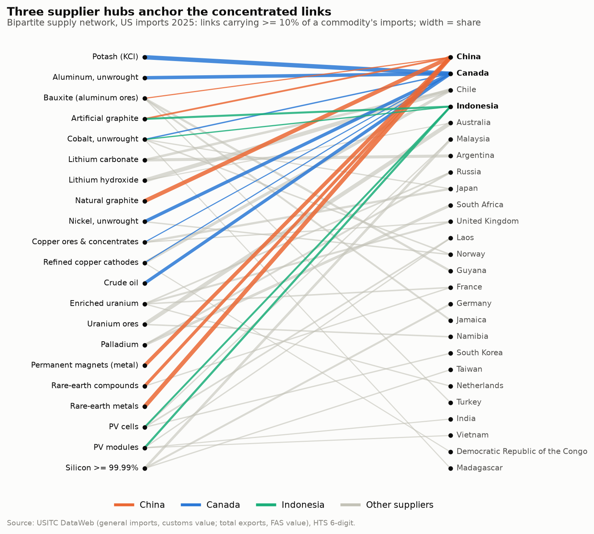

6 of 21 import lines behave like fewer than two equal suppliers in 2025 (effective number of suppliers = 1/HHI < 2).

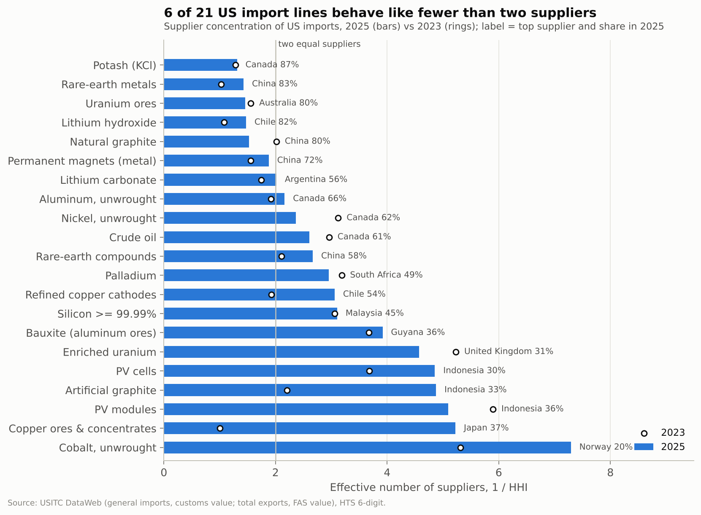

| commodity | 2025 value, $M | HHI | N_eff | top supplier 2025 | share | top supplier 2023 | share 2023 |
| --- | --- | --- | --- | --- | --- | --- | --- |
| Potash (KCl) | 3,297.0 | 0.762 | 1.31 | Canada | 87% | Canada | 88% |
| Rare-earth metals | 8.1 | 0.700 | 1.43 | China | 83% | China | 99% |
| Uranium ores | 751.0 | 0.685 | 1.46 | Australia | 80% | Australia | 77% |
| Lithium hydroxide | 11.8 | 0.679 | 1.47 | Chile | 82% | Chile | 96% |
| Natural graphite | 6.2 | 0.656 | 1.52 | China | 80% | China | 67% |
| Permanent magnets (metal) | 391.7 | 0.532 | 1.88 | China | 72% | China | 80% |
| Lithium carbonate | 159.8 | 0.496 | 2.02 | Argentina | 56% | Chile | 70% |
| Aluminum, unwrought | 4,901.3 | 0.462 | 2.16 | Canada | 66% | Canada | 71% |
| Nickel, unwrought | 1,265.7 | 0.423 | 2.36 | Canada | 62% | Canada | 52% |
| Crude oil | 140,276.6 | 0.384 | 2.61 | Canada | 61% | Canada | 56% |
| Rare-earth compounds | 176.7 | 0.375 | 2.67 | China | 58% | China | 67% |
| Palladium | 2,422.1 | 0.338 | 2.96 | South Africa | 49% | Russia | 39% |
| Refined copper cathodes | 16,435.8 | 0.327 | 3.06 | Chile | 54% | Chile | 69% |
| Silicon >= 99.99% | 188.1 | 0.322 | 3.11 | Malaysia | 45% | Germany | 46% |
| Bauxite (aluminum ores) | 137.6 | 0.255 | 3.92 | Guyana | 36% | Jamaica | 41% |
| Enriched uranium | 4,384.0 | 0.219 | 4.58 | United Kingdom | 31% | Russia | 31% |
| PV cells | 2,451.8 | 0.206 | 4.86 | Indonesia | 30% | Malaysia | 46% |
| Artificial graphite | 529.2 | 0.205 | 4.88 | Indonesia | 33% | China | 66% |
| PV modules | 6,386.8 | 0.196 | 5.09 | Indonesia | 36% | Vietnam | 26% |
| Copper ores & concentrates | 0.6 | 0.191 | 5.22 | Japan | 37% | Canada | 100% |
| Cobalt, unwrought | 396.4 | 0.137 | 7.29 | Norway | 20% | Norway | 29% |

**Top supplier changed between 2023 and 2025:** Lithium carbonate (Chile to Argentina); Palladium (Russia to South Africa); Silicon >= 99.99% (Germany to Malaysia); Bauxite (aluminum ores) (Jamaica to Guyana); Enriched uranium (Russia to United Kingdom); PV cells (Malaysia to Indonesia); Artificial graphite (China to Indonesia); PV modules (Vietnam to Indonesia); Copper ores & concentrates (Canada to Japan, thin line under $10M).

### Centrality, communities and nestedness

Highest betweenness (countries bridging otherwise separate commodity supply chains): Canada (0.54), Indonesia (0.46), China (0.38), Chile (0.08), Malaysia (0.07).

Highest eigenvector centrality in the country projection: China (0.42), Canada (0.34), Japan (0.30), Indonesia (0.30), Germany (0.23).

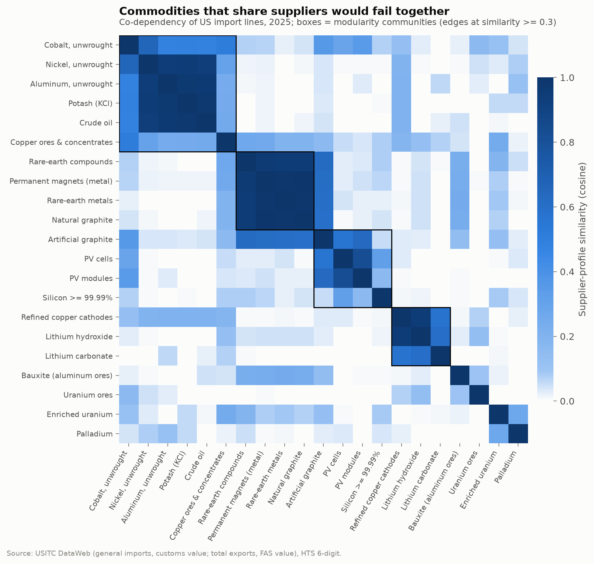

Co-dependency communities (commodities whose supplier profiles overlap, so one disruption hits all of them): Aluminum, unwrought, Cobalt, unwrought, Copper ores & concentrates, Crude oil, Nickel, unwrought, Potash (KCl) | Natural graphite, Permanent magnets (metal), Rare-earth compounds, Rare-earth metals | Artificial graphite, PV cells, PV modules, Silicon >= 99.99% | Lithium carbonate, Lithium hydroxide, Refined copper cathodes.

Nestedness NODF = 19.4 vs 19.9 ± 0.5 under a fixed-degree null (z = -1.00, one-sided p = 0.82). The supplier-commodity structure is **not** more nested than its degree sequence implies: concentration comes from a few dominant suppliers per line, not from a hidden nested hierarchy.

### Robustness and scenarios

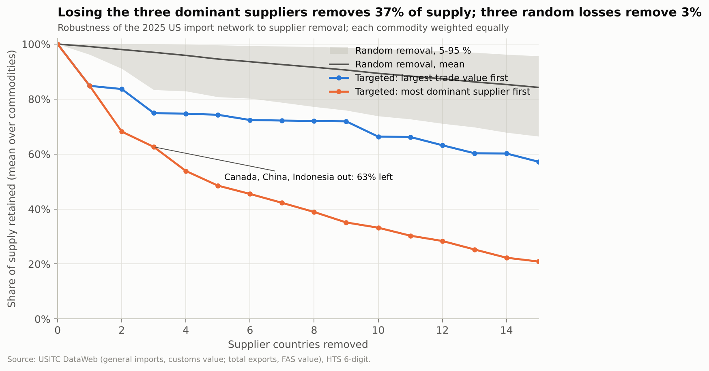

Removing the three most dominant suppliers (Canada, China, Indonesia) leaves 63% of supply (equal-weighted across commodities); removing the three largest by trade value (Canada, Mexico, Chile) leaves 75%. Robustness index R (mean retained over all removal steps): targeted-by-dominance 0.089, targeted-by-value 0.203, random 0.493.

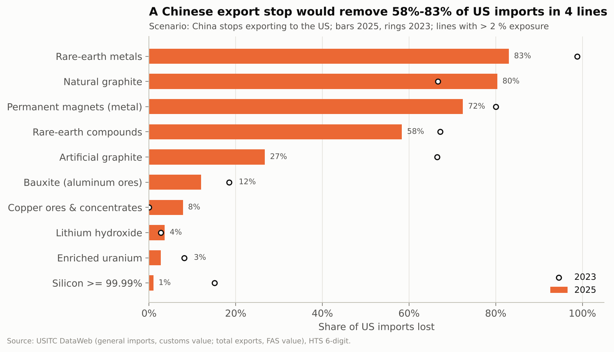

Supply lost per scenario, 2025 (lines with > 10 % loss in any scenario):

| commodity | Canada disruption | Chile + Peru disruption | China export restriction |
| --- | --- | --- | --- |
| Potash (KCl) | 87% | 0% | 0% |
| Rare-earth metals | 0% | 0% | 83% |
| Lithium hydroxide | 0% | 82% | 4% |
| Natural graphite | 0% | 0% | 80% |
| Permanent magnets (metal) | 1% | 0% | 72% |
| Aluminum, unwrought | 66% | 0% | 0% |
| Nickel, unwrought | 62% | 0% | 0% |
| Crude oil | 61% | 0% | 0% |
| Refined copper cathodes | 12% | 60% | 0% |
| Rare-earth compounds | 0% | 0% | 58% |
| Lithium carbonate | 0% | 43% | 0% |
| Artificial graphite | 1% | 0% | 27% |
| Cobalt, unwrought | 18% | 0% | 0% |
| Bauxite (aluminum ores) | 0% | 0% | 12% |
| Copper ores & concentrates | 11% | 7% | 8% |

### Monte Carlo supply-at-risk

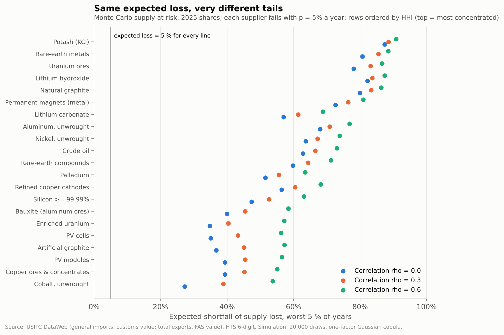

Every supplier fails independently with p = 5% a year (an illustrative prior), so expected loss is 4.8%-5.1% for every line. Concentration only moves the tail: the correlation between HHI and the 95 % expected shortfall is 0.97. Correlated failures (a common geopolitical factor, rho > 0) fatten the tail of the diversified lines most.

| commodity | HHI | ES95 rho=0.0 | ES95 rho=0.3 | ES95 rho=0.6 |
| --- | --- | --- | --- | --- |
| Potash (KCl) | 0.762 | 87% | 89% | 91% |
| Rare-earth metals | 0.700 | 81% | 85% | 88% |
| Uranium ores | 0.685 | 78% | 83% | 87% |
| Lithium hydroxide | 0.679 | 82% | 84% | 87% |
| Natural graphite | 0.656 | 80% | 83% | 86% |
| Permanent magnets (metal) | 0.532 | 73% | 76% | 81% |
| Lithium carbonate | 0.496 | 57% | 61% | 69% |
| Aluminum, unwrought | 0.462 | 68% | 71% | 77% |

### Demand side: buyer concentration of US exports

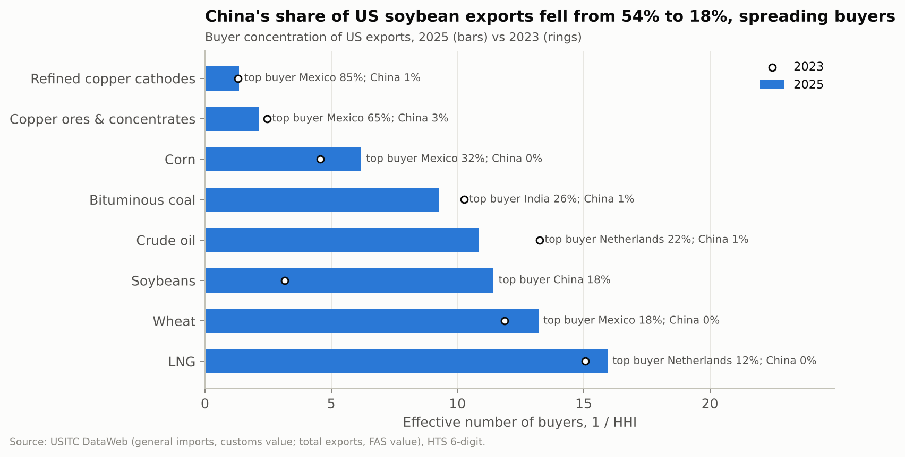

| commodity | 2025 value, $M | N_eff 2025 | top buyer 2025 | share | N_eff 2023 | top buyer 2023 | share 2023 |
| --- | --- | --- | --- | --- | --- | --- | --- |
| Refined copper cathodes | 1,712 | 1.4 | Mexico | 85% | 1.3 | Mexico | 87% |
| Copper ores & concentrates | 3,560 | 2.1 | Mexico | 65% | 2.5 | Mexico | 58% |
| Corn | 18,666 | 6.2 | Mexico | 32% | 4.6 | Mexico | 41% |
| Bituminous coal | 9,650 | 9.3 | India | 26% | 10.3 | India | 23% |
| Crude oil | 99,368 | 10.8 | Netherlands | 22% | 13.3 | Netherlands | 15% |
| Soybeans | 16,201 | 11.4 | China | 18% | 3.2 | China | 54% |
| Wheat | 6,158 | 13.2 | Mexico | 18% | 11.9 | Mexico | 19% |
| LNG | 44,223 | 15.9 | Netherlands | 12% | 15.1 | Netherlands | 13% |

## 2. Supply nowcast (Permian proxy: Texas + New Mexico crude output)

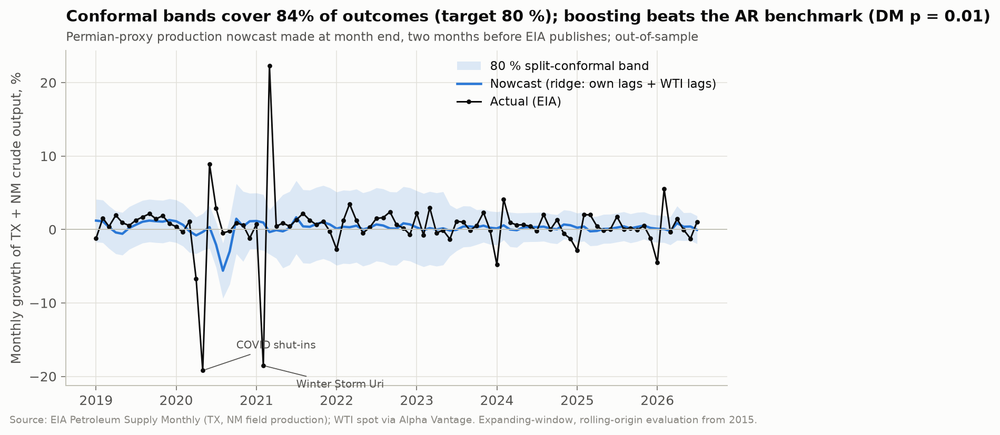

Out-of-sample, 2015-01-01 to 2026-07-01 (139 months), target = monthly log growth, nowcast made two months before EIA publishes.

| model | rmse | mae | pinball_q50 | dm_vs_ar_stat | dm_vs_ar_p |
| --- | --- | --- | --- | --- | --- |
| naive | 0.0514 | 0.0282 | 0.0141 | 2.43 | 0.016 |
| ar | 0.0368 | 0.0189 | 0.0095 |  |  |
| ridge | 0.0360 | 0.0179 | 0.0089 | -1.37 | 0.172 |
| gbm_q50 | 0.0351 | 0.0173 | 0.0086 | -2.58 | 0.011 |

Quantile-boosting 10-90 % interval coverage: 65% (nominal 80 %); split-conformal 80 % band around the ridge nowcast: 84%. The conformal band, calibrated on the most recent published errors, lands near its nominal level; the boosted quantile band, which has no calibration step, is too narrow.

Satellite experiment: not run: no VIIRS Nightfire series yet (run 02 --live --module permian)

## 3. Macro regimes

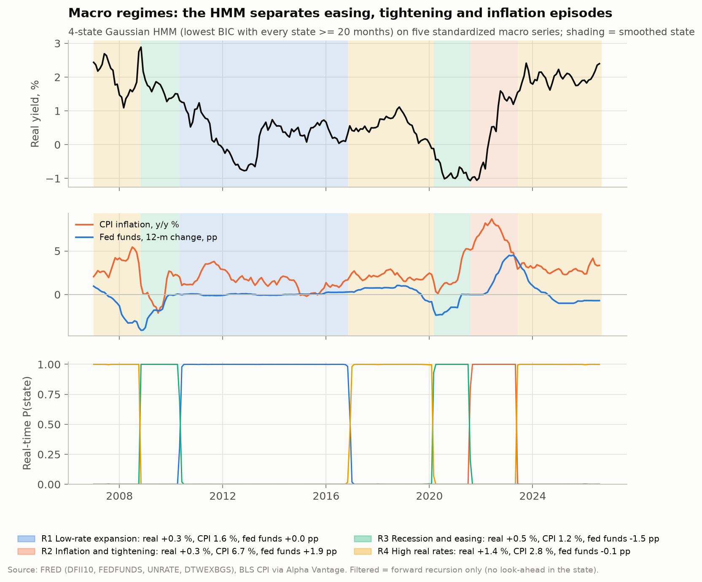

| k | loglik | n_params | bic | min_state_obs | eligible | selected |
| --- | --- | --- | --- | --- | --- | --- |
| 2 | -1226.5 | 43 | 2687.9 | 91 | True | False |
| 3 | -859.2 | 68 | 2089.9 | 55 | True | False |
| 4 | -663.2 | 95 | 1845.5 | 22 | True | True |
| 5 | -533.4 | 124 | 1744.3 | 17 | False | False |

BIC keeps falling at k = 5, but the five-state model leaves a regime with fewer than 20 months, too few to condition anything on; the occupancy rule selects k = 4.

| state_smoothed | real10 | d12_fedfunds | cpi_yoy | d12_unrate | usd_yoy | label | months | persistence |
| --- | --- | --- | --- | --- | --- | --- | --- | --- |
| R1 | 0.29 | 0.03 | 1.56 | -0.74 | 2.78 | Low-rate expansion | 78 | 0.99 |
| R2 | 0.31 | 1.87 | 6.72 | -1.63 | 4.04 | Inflation and tightening | 22 | 0.95 |
| R3 | 0.50 | -1.51 | 1.18 | 2.48 | 1.00 | Recession and easing | 35 | 0.94 |
| R4 | 1.40 | -0.05 | 2.75 | 0.03 | -1.06 | High real rates | 101 | 0.98 |

Latest month 2026-08-01: filtered state R4 ({"p_R1": 0.0, "p_R2": 0.0, "p_R3": 0.001, "p_R4": 0.999}). Filtered and smoothed states agree in 99% of months.

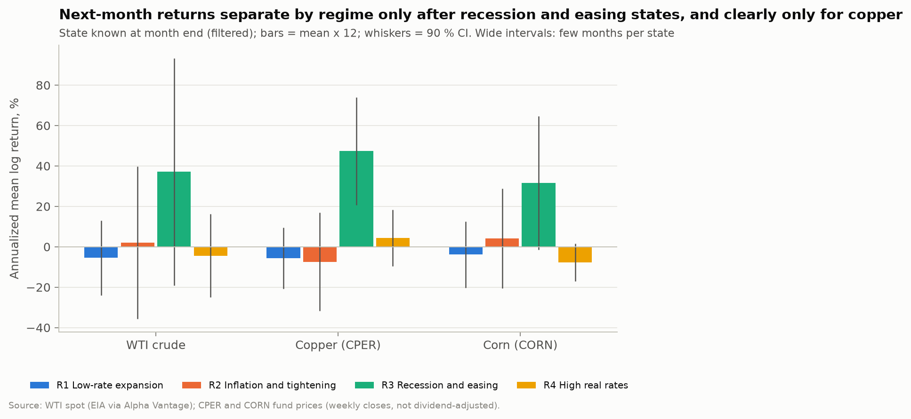

| asset | state | n | mean_pct | vol_pct | se | ann_mean_pct |
| --- | --- | --- | --- | --- | --- | --- |
| WTI crude | R1 | 79 | -0.46 | 8.31 | 0.93 | -5.5 |
| WTI crude | R2 | 22 | 0.17 | 8.95 | 1.91 | 2.0 |
| WTI crude | R3 | 36 | 3.10 | 17.09 | 2.85 | 37.2 |
| WTI crude | R4 | 98 | -0.37 | 10.36 | 1.05 | -4.4 |
| Copper (CPER) | R1 | 62 | -0.46 | 6.05 | 0.77 | -5.6 |
| Copper (CPER) | R2 | 22 | -0.62 | 5.78 | 1.23 | -7.4 |
| Copper (CPER) | R3 | 17 | 3.94 | 5.55 | 1.35 | 47.3 |
| Copper (CPER) | R4 | 76 | 0.36 | 6.19 | 0.71 | 4.4 |
| Corn (CORN) | R1 | 79 | -0.32 | 7.36 | 0.83 | -3.9 |
| Corn (CORN) | R2 | 22 | 0.34 | 5.86 | 1.25 | 4.1 |
| Corn (CORN) | R3 | 17 | 2.63 | 6.90 | 1.67 | 31.5 |
| Corn (CORN) | R4 | 76 | -0.64 | 4.12 | 0.47 | -7.7 |

## 4. Price response to supply surprises (local projections)

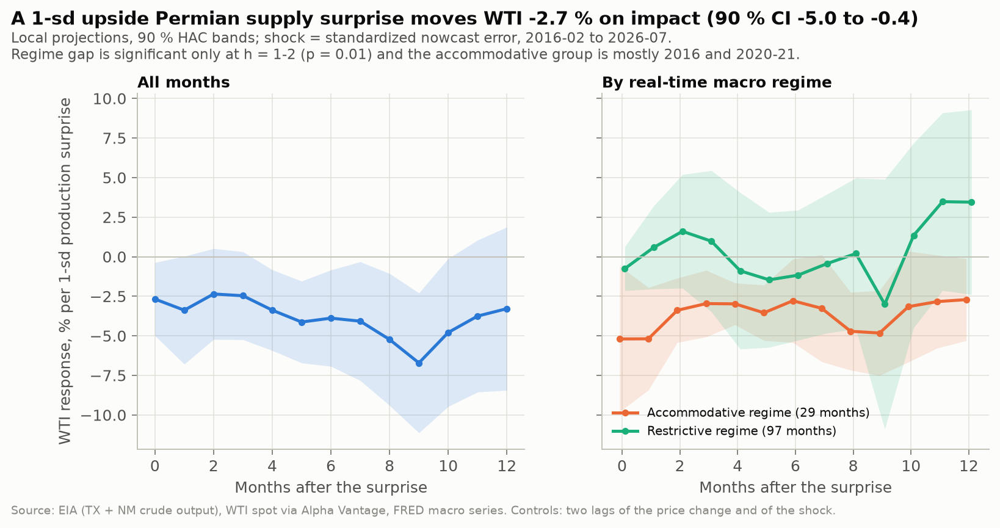

Shock months 2016-02-01 to 2026-07-01; months by state: {"restrictive": 97, "accommodative": 29}. Response of 100 x log WTI to a one-standard-deviation upside production surprise:

| h | accommodative | all | restrictive | p(equal regimes) |
| --- | --- | --- | --- | --- |
| 0 | -5.20 | -2.68 | -0.76 | 0.12 |
| 1 | -5.19 | -3.38 | 0.58 | 0.01 |
| 2 | -3.39 | -2.36 | 1.60 | 0.05 |
| 3 | -2.96 | -2.47 | 0.98 | 0.20 |
| 6 | -2.78 | -3.88 | -1.17 | 0.60 |
| 9 | -4.82 | -6.71 | -3.00 | 0.73 |
| 12 | -2.71 | -3.28 | 3.45 | 0.13 |

Caveat: the accommodative group is concentrated in 2016 and 2020-21, so the regime contrast partly reflects the COVID shut-in and rebound; the linear response is the robust result.

## 5. 2025 copper disruptions (weekly event study)

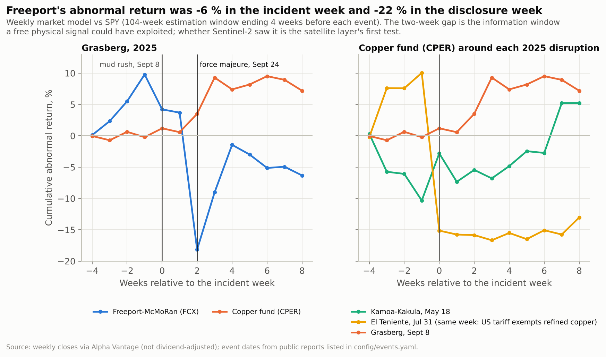

| name | ticker | event_week | beta | ar_week0 | t_week0 | car_0_2 | t_car |
| --- | --- | --- | --- | --- | --- | --- | --- |
| Kamoa-Kakula seismic event and flooding | CPER | 2025-05-23 | 0.59 | +7.5% | 2.53 | +4.9% | 0.95 |
| El Teniente Andesita sector collapse | CPER | 2025-08-01 | 0.49 | -25.2% | -8.03 | -25.9% | -4.77 |
| Grasberg Block Cave mud rush | FCX | 2025-09-12 | 1.64 | -5.6% | -1.24 | -27.9% | -3.58 |
| Grasberg Block Cave mud rush | CPER | 2025-09-12 | 0.61 | +1.4% | 0.35 | +3.7% | 0.53 |
| Grasberg force majeure declared | FCX | 2025-09-26 | 1.63 | -21.9% | -4.87 | -5.4% | -0.69 |
| Grasberg force majeure declared | CPER | 2025-09-26 | 0.61 | +3.0% | 0.73 | +6.9% | 0.99 |

Confounded: El Teniente Andesita sector collapse - US 50 % copper tariff excluding refined cathode, announced July 30, 2025; COMEX copper futures fell 22 % that day.

## 6. Satellite layer

Satellite outputs present: `copper_activity_monthly.csv`, `copper_breaks.csv`, `copper_hotspot_scenes.csv`, `corn_ndvi_weekly.csv`, `corn_season_summary.csv`, `corn_vegetation_scenes.csv`.

